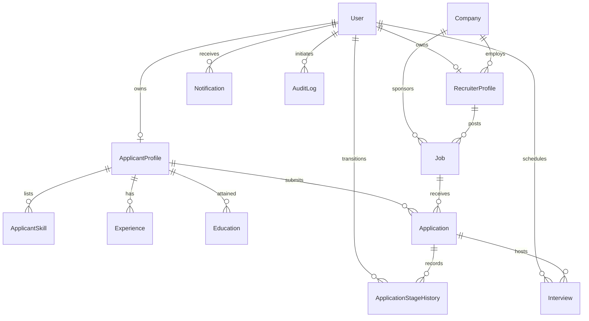

# Project Analysis: HireFlow — Enterprise Applicant Tracking & Recruitment Platform

> **Comprehensive Technical Analysis & Architectural Reference**  
> **Workspace:** `HireFlow-main`  
> **Generated on:** 2026-11-13

---

## 1. Project Overview & Identity

### What is HireFlow?
**HireFlow** is an enterprise-grade, full-stack **Applicant Tracking System (ATS)** and recruitment operations platform designed for high-velocity talent acquisition teams, hiring managers, engineering candidates, and platform administrators.

It replaces disjointed recruitment tools (spreadsheets, third-party email threads, manual calendars) with a unified, multi-tenant workspace featuring:
- **Interactive Drag-and-Drop Kanban Recruitment Pipelines** (6 stages with immutable audit history).
- **Intelligent Interview Scheduling with Collision Detection** (preventing double-booking).
- **Secure Candidate & Resume Management** with Broken Object-Level Authorization (BOLA) safeguards and cloud storage abstraction (AWS S3 & Local Disk).
- **Granular Multi-Tenant Role-Based Access Control (RBAC)** across three distinct roles: `SUPER_ADMIN`, `RECRUITER`, and `APPLICANT`.
- **Event-Driven In-App Notifications** keeping applicants and recruiters synchronized in real time.
- **Enterprise Security Hardening** with Helmet, strict CORS whitelisting, dual-tier rate limiting, Zod validation, and bcrypt password hashing.

---

## 2. High-Level System Architecture

HireFlow uses a **decoupled, three-tier client-server architecture** with separate presentation, API/domain logic, and data persistence layers:

```
┌──────────────────────────────────────────────────────────────────────────┐
│                               CLIENT TIER                                │
│        Next.js 14 (App Router) + React 18 + TypeScript + Tailwind CSS     │
│         @dnd-kit Kanban Board | Recharts Visual Analytics | Lucide Icons │
└────────────────────────────────────┬─────────────────────────────────────┘
                                     │ HTTPS / REST API / JSON
                                     │ Authorization: Bearer <JWT Access Token>
┌────────────────────────────────────▼─────────────────────────────────────┐
│                           API SERVICE TIER                               │
│           Node.js 20+ | Express.js 4.21 | Strict TypeScript              │
│ ──────────────────────────────────────────────────────────────────────── │
│  Security Layer : Helmet | Strict CORS | Global & Auth Rate Limiters     │
│  Validation     : Zod Schemas on every route payload                     │
│  Auth & RBAC    : JWT (Access 7d + Refresh 30d) | Role Guards            │
│  Business Logic : Controllers -> Services -> Atomic Prisma Transactions  │
│  Documentation  : Interactive Swagger UI & OpenAPI 3.0 (/api/docs)       │
└───────────────────┬──────────────────────────────────┬───────────────────┘
                    │                                  │
                    │ Prisma ORM 5.x Client            │ AWS SDK v3 Presigner
                    │ (PostgreSQL 16)                  │ (Time-limited Signed URLs)
┌───────────────────▼──────────────────┐  ┌────────────▼──────────────────┐
│         DATABASE TIER                │  │      OBJECT STORAGE TIER      │
│  PostgreSQL 16 (Production & Dev)    │  │  AWS S3 Private Bucket        │
│  - 13 Relational Tables              │  │  - Zero public bucket access  │
│  - 9 Native Enums                    │  │  - 15-minute Pre-signed URLs  │
│  - Cascading Foreign Keys & Indexes  │  │  - PDF/DOC/DOCX up to 5MB     │
│  - Performance B-Tree Indexes        │  │  (Fallback: Local Disk /uploads)│
└──────────────────────────────────────┘  └───────────────────────────────┘
```

---

## 3. Detailed Technology Stack Breakdown

### 3.1. Frontend Stack (`/client`)

| Technology | Version | Purpose & Architectural Justification |
| :--- | :--- | :--- |
| **Next.js** | `^14.2.18` | React framework using **App Router** for file-system routing, Server Components, layout persistence, and standalone Docker packaging. |
| **React & React-DOM** | `^18.3.1` | Core UI library for declarative, reactive state updates and optimistic UI synchronization. |
| **TypeScript** | `^5.6.3` | Enforces compile-time type safety across UI components, API contracts, and context states. |
| **Tailwind CSS** | `^3.4.14` | Utility-first CSS engine for responsive layouts, design token styling, and transition animations. |
| **@dnd-kit/core** | `^6.3.1` | Lightweight, accessible, performant drag-and-drop engine powering the 6-stage candidate Kanban pipeline. |
| **@dnd-kit/sortable** | `^10.0.0` | Enables fluid candidate card reordering inside and between recruitment stage columns. |
| **Recharts** | `^2.13.3` | Composable charting library visualizing recruitment funnels, stage distribution, and hiring KPIs. |
| **Lucide React** | `^0.460.0` | Clean, modern iconography across navigation, status badges, and action buttons. |
| **Axios** | `^1.7.9` | HTTP client configured with request interceptors (Bearer token attachment) and response interceptors (auto-redirection on 401). |
| **React Hook Form** | `^7.53.2` | High-performance, uncontrolled form management for job creation, candidate profile edits, and application modals. |
| **Zod** | `^3.23.8` | Client-side schema definition and input validation shared with backend patterns. |
| **clsx & tailwind-merge** | `^2.1.1` / `^2.5.4` | Safe conditional class merging avoiding Tailwind class collisions. |

#### Frontend Directory & Component Structure:
- `client/src/app/`: Next.js 14 App Router routes:
  - `(auth)/login` & `(auth)/register`: Authentication flows with role selection.
  - `dashboard`: Dynamic dashboard rendering `AdminDashboard`, `RecruiterDashboard`, or `ApplicantDashboard` based on the active role.
  - `jobs`: Public job catalog with keyword/location/department search, plus recruiter job requisition creation (`/jobs/create`) and editing (`/jobs/[id]/edit`).
  - `applications/kanban`: Interactive recruitment pipeline for recruiters to manage candidates across stages.
  - `applications/my`: Real-time application tracking dashboard for candidates.
  - `applicants`: Recruiter candidate pool and search directory.
  - `applicants/[id]`: Candidate profile view with resume download and stage transition history.
  - `interviews`: Recruiter & applicant interview schedule tracker.
  - `admin/users`, `admin/companies`, `admin/audit`: Administrative platform control and security audit logs.
  - `profile`: Candidate resume upload, work experience, education, and skill tags.
- `client/src/components/kanban/`: `KanbanBoard.tsx`, `KanbanColumn.tsx`, `KanbanCard.tsx`, `StageHistoryModal.tsx`.
- `client/src/components/dashboard/`: `AdminDashboard.tsx`, `RecruiterDashboard.tsx`, `ApplicantDashboard.tsx`.
- `client/src/components/layout/`: `Navbar.tsx` (with notifications popover & demo role switcher), `Sidebar.tsx`, `AuthGuard.tsx`.
- `client/src/providers/`: `AuthContext.tsx` (session persistence) and `ToastContext.tsx` (accessible alerts).

---

### 3.2. Backend Stack (`/server`)

| Technology | Version | Purpose & Architectural Justification |
| :--- | :--- | :--- |
| **Node.js** | `>=20.x` | High-performance asynchronous JavaScript/TypeScript runtime. |
| **Express.js** | `^4.21.2` | Industry-standard web application server framework handling routing, middleware chains, and HTTP responses. |
| **TypeScript** | `^5.7.2` | Strict compile-time type verification, strong typing for Express `Request` extensions (`req.user`), and maintenance scalability. |
| **Prisma ORM** | `^5.22.0` | Type-safe database client and migration manager supporting schema migrations, complex joins, and transactional atomic mutations. |
| **Helmet** | `^8.0.0` | HTTP security middleware configuring `X-Frame-Options`, `Content-Security-Policy`, `X-Content-Type-Options`, and hiding `X-Powered-By`. |
| **CORS** | `^2.8.5` | Cross-Origin Resource Sharing middleware restricting API access strictly to authorized frontend origins. |
| **express-rate-limit** | `^8.7.1` | DoS and brute-force defense: Global API limiter (1,000 req/15 min) and Auth limiter (50 req/15 min). |
| **jsonwebtoken** | `^9.0.2` | Cryptographic JWT signing and validation implementing dual-token authentication (Access + Refresh tokens). |
| **bcryptjs** | `^2.4.3` | Cryptographic password hashing using salt rounds (work factor 10) for secure credential storage. |
| **Zod** | `^3.24.1` | Runtime schema validation middleware enforcing strict type checking on request bodies, query params, and URL route parameters. |
| **Multer** | `^1.4.5-lts.1` | Multipart form-data parser for resume file uploads with strict MIME-type guards (`.pdf`, `.doc`, `.docx`) and a 5MB size limit. |
| **@aws-sdk/client-s3** | `^3.1153.0` | AWS S3 client for cloud file uploads and private storage bucket management. |
| **@aws-sdk/s3-request-presigner** | `^3.1153.0` | Generates short-lived, authenticated pre-signed URLs (15-minute expiration) for BOLA-protected resume downloads. |
| **Swagger UI Express & YAMLjs** | `^5.0.1` / `^0.3.0` | Serves interactive OpenAPI 3.0 API documentation at `/api/docs`. |
| **Jest & Supertest** | `^29.7.0` / `^7.0.0` | Automated integration testing framework executing against real database transactions. |

#### Backend Layered Architecture:
```
Incoming Request
  │
  ▼
[Security Middleware] ──► Helmet Headers, CORS Whitelist, Morgan Logger, Rate Limiting
  │
  ▼
[Routing Layer] ────────► server/src/routes/ (auth, jobs, applications, candidates, etc.)
  │
  ▼
[Auth & RBAC Guards] ───► authenticate (JWT verify) & authorizeRoles('RECRUITER', ...)
  │
  ▼
[Validation Layer] ─────► Zod Schema Middleware (validates input before reaching controllers)
  │
  ▼
[Controller Layer] ─────► Extracts params, calls services, sends HTTP status & response
  │
  ▼
[Service Layer] ────────► Implements business rules, BOLA checks, collision algorithms, transactions
  │
  ▼
[Data Layer] ───────────► Prisma ORM executing parameterized SQL queries against Database
```

---

### 3.3. Database Architecture & Modeling (`PostgreSQL 16`)

HireFlow features a **production-ready relational schema** designed with high normalization, strict foreign key constraints, cascading deletion rules, and B-Tree indexing.

#### PostgreSQL 16 Architecture:
1. **Canonical Schema**: `server/prisma/schema.prisma` configured with provider `postgresql` using `env("DATABASE_URL")`.
2. **Deterministic Migrations**: Native PostgreSQL migrations located in `server/prisma/migrations/`.
3. **Serverless Connection Pooling**: Global client singleton preventing connection pool exhaustion in serverless runtimes.

#### The 13 Database Tables:

| # | Table Name | Purpose & Contents | Relational Links |
| :---: | :--- | :--- | :--- |
| **1** | `User` | Core authentication record containing email, password hash, platform role (`SUPER_ADMIN`, `RECRUITER`, `APPLICANT`), and user status (`ACTIVE`, `SUSPENDED`). | 1:1 `RecruiterProfile`, 1:1 `ApplicantProfile`, 1:N `Notification`, 1:N `AuditLog`. |
| **2** | `Company` | Enterprise organization/tenant profile (name, industry, size, website, contact). | 1:N `RecruiterProfile`, 1:N `Job`, 1:N `User`. |
| **3** | `RecruiterProfile` | Recruiter profile metadata (title, department, phone). | 1:1 with `User`, N:1 with `Company`, 1:N with `Job`. |
| **4** | `ApplicantProfile` | Job candidate profile (full name, phone, headline, bio, resume URL, resume file name). | 1:1 with `User`, 1:N with `ApplicantSkill`, `Experience`, `Education`, `Application`. |
| **5** | `ApplicantSkill` | Individual candidate skills with proficiency level and years of experience. | N:1 with `ApplicantProfile`. |
| **6** | `Experience` | Candidate employment history (company, title, start/end dates, responsibilities). | N:1 with `ApplicantProfile`. |
| **7** | `Education` | Candidate educational credentials (institution, degree, field of study). | N:1 with `ApplicantProfile`. |
| **8** | `Job` | Job opening requisition (title, description, requirements, skills, location, salary min/max, status, deadline). | N:1 with `Company`, N:1 with `RecruiterProfile`, 1:N with `Application`. |
| **9** | `Application` | Candidate application submission linking applicant to job. Composite unique constraint `@@unique([jobId, applicantId])` prevents duplicate applications. | N:1 with `Job`, N:1 with `ApplicantProfile`, 1:N with `ApplicationStageHistory`, `Interview`. |
| **10** | `ApplicationStageHistory` | Immutable audit trail tracking candidate stage transitions, previous stage, new stage, actor user ID, reason, and timestamp. | N:1 with `Application`, N:1 with `User` (actor). |
| **11** | `Interview` | Scheduled interview rounds (round type, date, start time, end time, interviewer name/email, meeting link, status). | N:1 with `Application`, N:1 with `User` (scheduler). |
| **12** | `Notification` | In-app alerts delivered to users for application updates, interview invites, and system notices. | N:1 with `User`. |
| **13** | `AuditLog` | Security and compliance audit log recording critical mutations (stage changes, job postings, logins, IP address, user agent). | N:1 with `User` (`ON DELETE SET NULL`). |

#### The 9 Native PostgreSQL Enums:
1. `Role`: `SUPER_ADMIN`, `COMPANY`, `RECRUITER`, `APPLICANT`
2. `UserStatus`: `ACTIVE`, `SUSPENDED`, `PENDING`
3. `ApplicationStage`: `APPLIED`, `SCREENING`, `SHORTLISTED`, `INTERVIEW`, `SELECTED`, `REJECTED`
4. `JobStatus`: `DRAFT`, `PUBLISHED`, `ARCHIVED`
5. `EmploymentType`: `FULL_TIME`, `PART_TIME`, `CONTRACT`, `INTERNSHIP`
6. `ExperienceLevel`: `ENTRY_LEVEL`, `MID_LEVEL`, `SENIOR`, `LEAD`, `EXECUTIVE`
7. `InterviewType`: `TECHNICAL`, `HR`, `MANAGERIAL`, `BEHAVIORAL`, `FINAL`
8. `InterviewStatus`: `SCHEDULED`, `COMPLETED`, `CANCELLED`, `RESCHEDULED`
9. `NotificationType`: `APPLICATION_STATUS`, `INTERVIEW_SCHEDULED`, `NEW_APPLICATION`, `SYSTEM`

#### Entity Relationship Diagram (ERD):


---

## 4. Key Workflows & Business Logic

### 4.1. Kanban Pipeline & Stage Transition Workflow
1. **User Action**: Recruiter drags candidate card from `SCREENING` to `SHORTLISTED` on the Kanban board (`KanbanBoard.tsx`).
2. **Optimistic UI Update**: The card visually transfers immediately using `@dnd-kit`, giving instant user feedback.
3. **HTTP Dispatch**: Sends `PATCH /api/applications/:id/stage` with `{ "stage": "SHORTLISTED", "reason": "Passed initial screening" }`.
4. **RBAC & Multi-Tenant Isolation**:
   - `authenticate` middleware verifies JWT access token.
   - `authorizeRoles('RECRUITER', 'SUPER_ADMIN')` validates role.
   - `applicationService.changeStage()` verifies that the recruiter's `companyId` matches the job's `companyId`. Mismatches throw `403 Forbidden`.
5. **Database Transaction (Prisma `$transaction`)**:
   - Atomically updates `Application.currentStage` to `SHORTLISTED`.
   - Inserts a new record into `ApplicationStageHistory` with previous stage, target stage, actor user ID, reason, and timestamp.
6. **Notification Trigger**: `notificationService.notify()` creates an in-app notification for the applicant.
7. **Security Audit**: `auditService.log()` logs the `APPLICATION_STAGE_CHANGE` event.

### 4.2. Interview Scheduling with Conflict Detection Algorithm
When a recruiter schedules an interview via `POST /api/interviews`:
- The service executes a **time-window overlap query** against all existing interviews for the specified interviewer on that date:
  $$\text{Collision Condition: } (\text{newStartTime} < \text{existingEndTime}) \land (\text{newEndTime} > \text{existingStartTime})$$
- If an overlap is detected, the server aborts the transaction and returns **`HTTP 409 Conflict`** with a clear collision message.
- Upon successful scheduling:
  - An `Interview` record is inserted.
  - The linked application's stage automatically advances to `INTERVIEW`.
  - A notification is automatically dispatched to the applicant.

### 4.3. Resume Storage Abstraction & BOLA Protection
Resumes represent sensitive candidate PII. HireFlow implements **Broken Object-Level Authorization (BOLA)** defense:
1. Resumes are uploaded via `POST /api/candidates/resume/upload` (Multer, 5MB limit, PDF/DOC/DOCX only).
2. Resumes are stored either on local disk (`server/uploads/`) or streamed directly to private AWS S3 buckets (`resumes/<uuid>-<filename>`).
3. S3 buckets are **100% private with public access blocked**.
4. When downloading via `GET /api/candidates/resumes/:filename`:
   - An **Applicant** can ONLY download their own resume.
   - A **Recruiter** can ONLY download resumes of candidates who have actively submitted an application to a job at that recruiter's specific company.
   - Cross-company recruiters and unrelated applicants receive **`HTTP 403 Forbidden`**.
   - Upon authorization, the server generates a **15-minute expiring AWS S3 Pre-signed URL** via `@aws-sdk/s3-request-presigner` and returns an HTTP 302 redirect. AWS credentials are never exposed to the client.

---

## 5. REST API Architecture & Endpoints

All endpoints are hosted under `/api` and document schema contracts via OpenAPI 3.0 at `/api/docs`:

| Module | Method & Path | Auth Required | Description |
| :--- | :--- | :---: | :--- |
| **Authentication** | `POST /api/auth/register` | Public | Register new candidate or recruiter account. |
| | `POST /api/auth/login` | Public | Authenticate user, return JWT Access & Refresh tokens. |
| | `POST /api/auth/refresh` | Public | Exchange refresh token for new access token. |
| | `GET /api/auth/me` | Bearer | Retrieve active session user profile and company data. |
| | `POST /api/auth/logout` | Bearer | Invalidate session tokens. |
| **Jobs** | `GET /api/jobs` | Public | Paginated job list with keyword, department, and salary filters. |
| | `POST /api/jobs` | Recruiter/Admin | Create a new job requisition. |
| | `GET /api/jobs/:id` | Public | Retrieve detailed job specification and company info. |
| | `PUT /api/jobs/:id` | Recruiter/Admin | Update job requisition details. |
| | `PATCH /api/jobs/:id` | Recruiter/Admin | Update job lifecycle status (`DRAFT`, `PUBLISHED`, `ARCHIVED`). |
| | `DELETE /api/jobs/:id` | Recruiter/Admin | Delete job requisition and cascade dependent entities. |
| **Applications** | `POST /api/applications` | Applicant | Submit job application with cover letter and resume link. |
| | `GET /api/applications/my` | Applicant | Retrieve current applicant's active applications. |
| | `GET /api/applications/job/:jobId` | Recruiter/Admin | Fetch all applications for a job grouped by Kanban stage. |
| | `PATCH /api/applications/:id/stage` | Recruiter/Admin | Move application across Kanban stages with audit reason. |
| | `GET /api/applications/:id/history`| Recruiter/Admin | Retrieve stage transition audit history. |
| **Candidates** | `GET /api/candidates` | Recruiter/Admin | Multi-facet candidate search by skill, stage, or job. |
| | `GET /api/candidates/:id` | Recruiter/Admin | Detailed candidate CV, work experience, and education. |
| | `POST /api/candidates/resume/upload` | Applicant | Multipart resume upload (PDF/DOCX, 5MB). |
| | `GET /api/candidates/resumes/:file` | Authenticated | BOLA-protected resume download endpoint. |
| | `POST /api/candidates/skills` | Applicant | Batch update candidate skills. |
| **Interviews** | `POST /api/interviews` | Recruiter/Admin | Schedule interview round with conflict checking. |
| | `GET /api/interviews/my` | Authenticated | Retrieve upcoming and past interviews for active user. |
| | `PATCH /api/interviews/:id/status` | Recruiter/Admin | Update interview status (`SCHEDULED`, `COMPLETED`, `CANCELLED`). |
| **Notifications** | `GET /api/notifications` | Authenticated | Retrieve paginated in-app alerts and unread count. |
| | `PATCH /api/notifications/:id/read` | Authenticated | Mark notification as read. |
| **Dashboard** | `GET /api/dashboard/recruiter` | Recruiter | Recruiter pipeline metrics, funnel counts, and upcoming interviews. |
| | `GET /api/dashboard/admin` | Admin | System-wide statistics, active companies, and user counts. |
| **Admin** | `GET /api/admin/users` | Admin | List all registered users across the platform. |
| | `PATCH /api/admin/users/:id/status`| Admin | Suspend or reactivate user accounts. |
| | `GET /api/audit` | Admin | Search immutable security audit log entries. |
| **System** | `GET /api/health` | Public | Health check verifying live database connection. |
| | `GET /api/docs` | Public | Interactive Swagger / OpenAPI 3.0 UI documentation. |

---

## 6. Security & Hardening Implementation

- **Strict CORS Protection**: Whitelists explicit frontend origins; wildcard `origin: *` is strictly forbidden in production.
- **Helmet Security Headers**: Enforces `X-Content-Type-Options: nosniff`, `X-Frame-Options: SAMEORIGIN`, and sets content security policies.
- **Dual-Tier Rate Limiting**:
  - Global API limiter: `1000 requests per 15 minutes`.
  - Authentication limiter: `50 requests per 15 minutes` preventing brute-force password guessing.
- **Cryptographic Password Hashing**: Passwords are hashed with `bcryptjs` (salt rounds 10); plaintext passwords and hashes are permanently stripped from all API outputs.
- **Strict Zod Input Validation**: Every endpoint validates payloads, enforcing string lengths, UUID formats, email formats, and number ranges before any database query executes.
- **Safe Error Responses**: In production (`NODE_ENV=production`), server errors return generic messages (`Internal Server Error`), concealing internal stack traces, SQL errors, and database connection strings.
- **Zero Client-Side Only Trust**: All permission checks, company tenant isolation checks, and ownership validations are re-verified on the server inside services.

---

## 7. Containerization & Deployment Architecture

### 7.1. Docker & Docker Compose (`docker-compose.yml`)
HireFlow is fully containerized into a multi-container stack:
1. `hireflow_postgres`: PostgreSQL 16 Alpine container with persistent named volume (`pgdata`).
2. `hireflow_backend`: Node.js Express server running on port `5001`.
3. `hireflow_frontend`: Next.js 14 standalone container running on port `3000`.

### 7.2. Cloud Deployment Topology
- **Vercel**: Deploy the frontend directory `client/` using `client/vercel.json`.
- **Render / Railway / Fly.io / AWS ECS**: Deploy the backend directory `server/` using the declarative blueprint `render.yaml` or Docker container.
- **Managed PostgreSQL**: AWS RDS, Neon, Supabase, or Render PostgreSQL.
- **AWS S3**: Cloud storage bucket for candidate resumes.

---

## 8. Automated Testing & Verification Status

The project includes automated integration tests executing against real database models:
```bash
npm test --prefix server
```
- **Auth & RBAC Suite** (`tests/auth_and_rbac.test.ts`): 14 tests verifying registration, bcrypt verification, JWT access/refresh token lifecycles, and role-based route gates.
- **Recruitment Pipeline Suite** (`tests/recruitment_pipeline.test.ts`): 14 tests verifying job creation, duplicate application rejection, 6-stage Kanban transitions, stage history logging, and interview conflict detection.
- **Applicant & Notifications Suite** (`tests/applicant_and_notifications.test.ts`): 10 tests verifying candidate profile updates, resume upload constraints, and notification triggers.
- **Standalone Security Verification** (`scripts/verify_security.js`): 12 automated checks for BOLA, cross-tenant isolation, file upload guards, and Helmet headers.
- **Production E2E Verification** (`scripts/verify_production_e2e.js`): 25-step simulated recruitment lifecycle.
- **Total Test Pass Rate**: **100% Pass (38 Jest tests + security & E2E verification)**.

---

## 9. Seed Dataset & Demo Credentials

The database comes pre-seeded with realistic enterprise recruiting data (`server/src/seeds/seed.ts`):
- **1 Super Admin**, **2 Enterprise Companies** (TechNova Solutions, QuantumLabs AI), **2 Recruiters**, **5 Candidates**, **21 Total Jobs**, **14 Applications**, **4 Scheduled Interviews**, and **43+ In-App Notifications**.

| Role | Email | Password | Access & Responsibilities |
| :--- | :--- | :--- | :--- |
| **Super Admin** | `admin@hireflow.dev` | `Admin@123456` | Platform KPIs, user suspension, audit logs, global job audit |
| **Recruiter (TechNova)** | `sarah.recruiter@technova.com` | `Recruiter@123456` | TechNova jobs, drag-and-drop Kanban candidate pipeline, interviews |
| **Recruiter (QuantumLabs)** | `marcus.recruiter@quantum.ai` | `Recruiter@123456` | QuantumLabs jobs, isolated candidate pipeline & AI engineering roles |
| **Applicant (Alex Morgan)** | `alex.dev@gmail.com` | `Applicant@123456` | Senior Full-Stack candidate (Shortlisted & Interviewed) |
| **Applicant (Elena Rostova)** | `elena.frontend@gmail.com` | `Applicant@123456` | Staff Frontend candidate (Selected / Offer stage) |
| **Applicant (David Chen)** | `david.fullstack@gmail.com` | `Applicant@123456` | Systems & Cloud candidate (Screening stage) |

> **Pro Tip:** In local development, click the **"Switch Demo Role"** button in the top navigation bar to instantaneously impersonate any role without re-entering credentials.

---

## 10. Summary Matrix

| Domain | Technology / Architecture | Key Highlights |
| :--- | :--- | :--- |
| **Application Type** | Enterprise Applicant Tracking System (ATS) | Multi-tenant, role-aware, end-to-end recruitment operations. |
| **Frontend** | Next.js 14, React 18, Tailwind CSS, TypeScript | App Router, `@dnd-kit` Kanban board, `recharts` analytics. |
| **Backend** | Node.js 20+, Express.js 4.21, TypeScript | Layered (Controller-Service-Data), Zod validation, Helmet, CORS. |
| **Database** | PostgreSQL 16 exclusively via Prisma ORM | 13 relational tables, 9 native enums, cascading deletes, B-tree indexes. |
| **File Storage** | AWS S3 SDK v3 / Local Disk fallback | 15-minute Pre-signed URLs, BOLA protection, 5MB file restrictions. |
| **Auth & Security** | JWT (Dual-Token), bcryptjs, express-rate-limit | Strict RBAC, cross-tenant isolation, audit trails (`AuditLog`). |
| **Testing & CI** | Jest, Supertest, ts-jest | 38 automated integration tests + security & E2E verification. |
| **DevOps** | Docker, Docker Compose, Render, Vercel | Turnkey container orchestration, production-ready configurations. |

